<p align="center">
  
</p>

<h1 align="center">Defold Tools</h1>

<p align="center">
  Write <a href="https://defold.com">Defold</a> games in a text editor,<br>
  and hear about your typos before the game does.
</p>

---

Defold Tools is two small programs and a VS Code extension:

| | What it is |
|---|---|
| **`defold-vet`** | A checker. It reads a Defold project and reports every name that points at nothing. |
| **`defoldpls`** | A language server and a toolbox. It gives an editor completion, hover, rename and a debugger, and it builds, runs, bundles and creates files from the command line. |
| **The VS Code extension** | The part you see. It starts `defoldpls` and shows what it says. |

It was made to solve the development problems of
[Lanterna Games](https://github.com/Lanterna-Games), and it has no ambition beyond
that. It is public because there was no reason to hide it. If it helps you too, take
it. Just read [Support](#support) first, so that nobody is disappointed later.

## Contents

- [The problem it solves](#the-problem-it-solves)
- [Before you start](#before-you-start)
- [Installing the programs](#installing-the-programs): [Linux](#linux), [macOS](#macos), [Windows](#windows)
- [Installing the VS Code extension, by hand](#installing-the-vs-code-extension-by-hand)
- [Your first five minutes](#your-first-five-minutes)
- [What it does](#what-it-does), one example at a time
- [Commands](#commands)
- [Settings](#settings)
- [When something goes wrong](#when-something-goes-wrong)
- [What it does not do](#what-it-does-not-do)
- [Going deeper](#going-deeper)
- [Support](#support)
- [Licence](#licence)

## The problem it solves

Defold addresses almost everything by text. A message, a component, an input action, a
collision group, a GUI node: in Lua each of them is a string, and nothing checks the
string.

```lua
msg.post("#spirte", "play_animation", { id = hash("hero") })  -- there is no "spirte"
if message_id == hash("colision_response") then               -- never true
if action_id == hash("p3_right") then                         -- no key is bound to it
```

None of these is an error to Lua. The game starts, and something quietly does not
happen. You find out by playing until you hit that line and noticing.

Everything needed to catch them is already in the project: collections, game objects,
GUI scenes, atlases and input bindings are text files that say which names exist.
Defold Tools reads them together with your scripts and tells you, as you type.

## Before you start

You need four things. The last one is optional.

| You need | Why | How to check |
|---|---|---|
| [Git](https://git-scm.com/downloads) | To download the code | `git --version` |
| [Go](https://go.dev/dl/), 1.27 or newer | The programs are built on your machine. You do not have to know Go | `go version` |
| [VS Code](https://code.visualstudio.com/) with the [Lua](https://marketplace.visualstudio.com/items?itemName=sumneko.lua) extension | The editor. The Lua extension understands Lua, and Defold Tools adds what is Defold's | `code --version` |
| The [Defold editor](https://defold.com/download/), installed | Only to build, run, debug and bundle the game, and to draw atlases. Checking, completion and renaming work without it | Open it once |

There is nothing to download ready-made. That sounds like work and is three commands.

## Installing the programs

Pick your system. Each block can be pasted as it is.

### Linux

```sh
git --version && go version
```

If one of them is missing: Git comes from your package manager (`sudo apt install git`,
`sudo dnf install git`, `sudo pacman -S git`), and Go from <https://go.dev/doc/install>.
The Go of an older distribution may be older than 1.27, so check what `go version` says.

```sh
git clone https://github.com/Lanterna-Games/defold-tools.git
cd defold-tools
go install ./cmd/...
```

The two programs are now in `~/go/bin`. Tell your shell to look there:

```sh
echo 'export PATH="$HOME/go/bin:$PATH"' >> ~/.bashrc    # ~/.zshrc if you use zsh
source ~/.bashrc
```

### macOS

With [Homebrew](https://brew.sh):

```sh
brew install git go
git clone https://github.com/Lanterna-Games/defold-tools.git
cd defold-tools
go install ./cmd/...
echo 'export PATH="$HOME/go/bin:$PATH"' >> ~/.zshrc
source ~/.zshrc
```

### Windows

In PowerShell:

```powershell
winget install -e --id Git.Git
winget install -e --id GoLang.Go
```

Close that window and open a new one, so that it knows about the two programs it just
got. Then:

```powershell
git clone https://github.com/Lanterna-Games/defold-tools.git
cd defold-tools
go install ./cmd/...
```

The two programs are now in `%USERPROFILE%\go\bin`, which the Go installer already put
on your `PATH`.

### Check that it worked

On any system:

```sh
defold-vet version
defoldpls version
```

Each prints its name and a version. If you get *command not found*, the `PATH` step was
skipped: see [When something goes wrong](#when-something-goes-wrong).

### Updating

```sh
cd defold-tools
git pull
go install ./cmd/...
```

Then build and install the extension again, as below.

## Installing the VS Code extension, by hand

The extension is not on the Marketplace. Lanterna Games does not want to maintain a
public repository; picture what it thinks of a storefront, with star ratings. So it is
installed the way software was installed before stores existed: you build it yourself
and feel briefly like a wizard. It is three commands, from the `defold-tools` directory:

```sh
go run ./editors/vscode/pack -output build/defold-tools.vsix
code --install-extension build/defold-tools.vsix
code --install-extension sumneko.lua
```

The first one builds the extension into one file, the second installs it, and the third
installs the Lua extension if you do not have it. There is no Node, no `npm install` and
no build step to wait for: the extension is plain JavaScript and one Go program packs it.

If `code` is not found, do it from inside VS Code: open the Extensions view, click
the `...` at its top, choose **Install from VSIX...** and pick
`build/defold-tools.vsix`.

**One thing to check.** The extension starts `defoldpls`, and looks for it in the
`PATH`. If VS Code says *defoldpls could not be started*, tell it where the program is.
Ask your terminal:

```sh
which defoldpls        # Linux and macOS
where.exe defoldpls    # Windows
```

and paste the answer into your settings (`Ctrl+Shift+P`, **Preferences: Open User
Settings (JSON)**):

```json
"defoldTools.server.path": "/home/you/go/bin/defoldpls"
```

## Your first five minutes

1. **Open your game in VS Code.** Open the folder that has `game.project` in it, not a
   folder above it or below it.
2. **Look for red underlines.** Mistakes are underlined in the files and listed in the
   Problems panel (`Ctrl+Shift+M`). A healthy project may have none, which is also an
   answer.
3. **Say yes to the question.** The first time, the extension offers to tell the Lua
   extension about the Defold API of your version. Accepting writes that into the
   `.vscode` folder of the project, and from then on `go.`, `msg.` and the rest
   complete, with their documentation.
4. **Break something on purpose.** Misspell a message or a component in a script. The
   underline appears while you type. Put the cursor on it and press `Ctrl+.` to be
   offered the fix.
5. **Press `F5`.** The game is built and started under the debugger. This is the step
   that needs the Defold editor installed.

That is the whole setup. The rest of this page is what each feature does. The keys are
those of Windows and Linux: on a Mac, read `Cmd` where it says `Ctrl`.

## What it does

The examples come from a tiny game made for this page: a hero, an enemy, two lamps, a
HUD and a level. Every screenshot is the real extension in a real VS Code, and every
output was printed by the real programs.

### Mistakes are underlined while you type

<table>
<tr>
<td width="40%" valign="top">

```lua
msg.post("#spirte", "play_animation",
    { id = hash("hero") })
```

The hero has a component called `sprite`. Nothing is called `spirte`, so the message
would go nowhere.

Point at the underline and the tool says what is wrong and what you probably meant.

</td>
<td>
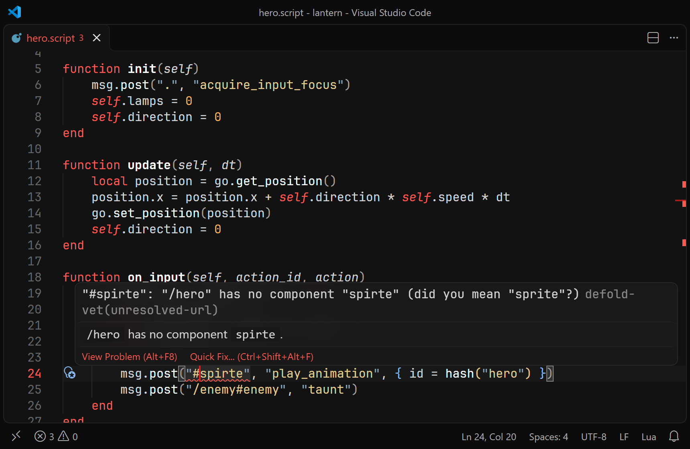
</td>
</tr>
<tr>
<td valign="top">

```lua
if message_id == hash("colision_response") then
```

A handler that waits for a message nobody sends. The engine sends
`collision_response`, with two l's.

</td>
<td>
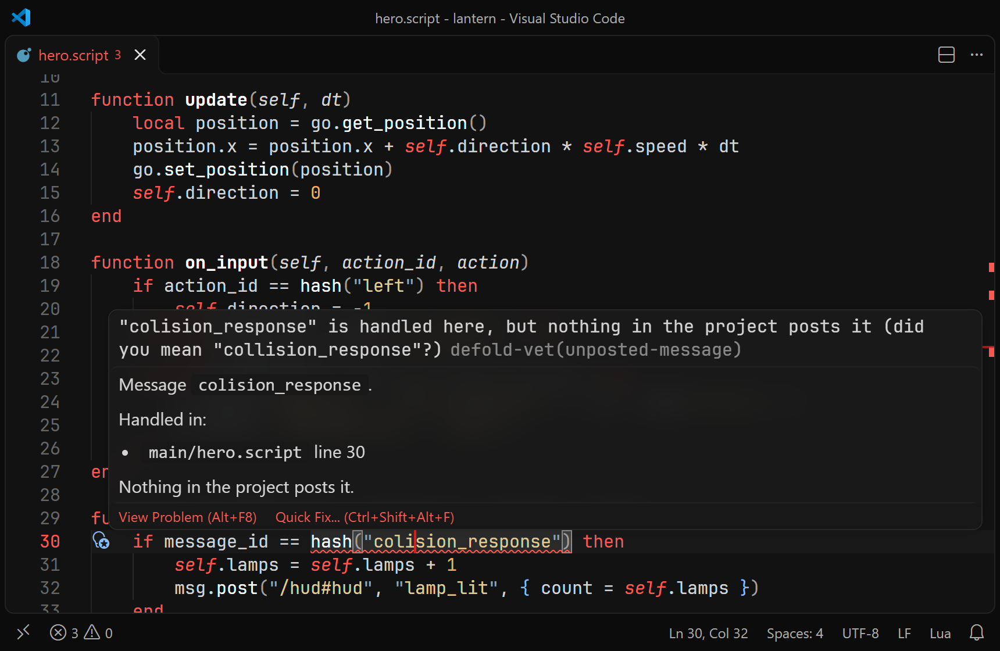
</td>
</tr>
<tr>
<td valign="top">

```lua
elseif action_id == hash("p3_right") then
```

An input action that no key is bound to. The input binding of the game has `left`,
`right` and `jump`.

</td>
<td>
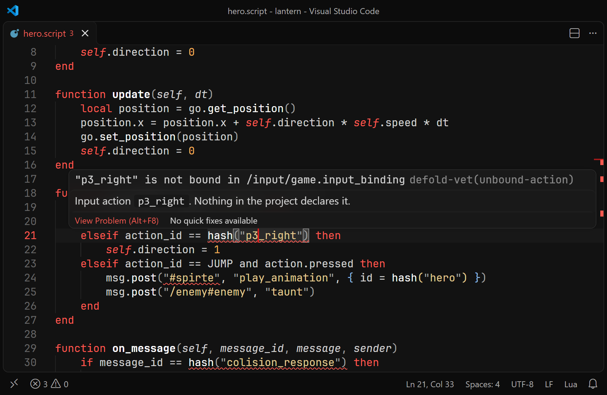
</td>
</tr>
</table>

<details><summary><b>The twenty-one kinds of problem it finds</b></summary><br>

| Check | In one line |
|---|---|
| `unresolved-url` | An address that leads to no game object or component |
| `unhandled-message` | A message posted to something that does not handle it |
| `unposted-message` | A handler waiting for a message nothing posts |
| `unknown-message-field` | A field read from a message that does not carry it |
| `unknown-property` | A property its game object or component does not have |
| `undeclared-property` | A script property the script does not declare |
| `unassigned-self-field` | A field of `self` that is read and never assigned |
| `unbound-action` | An input action no binding binds |
| `unknown-collision-group` | A collision group nothing is in |
| `unknown-gui-node` | A GUI node the scene does not have |
| `unknown-animation` | An animation the atlas or tile source does not have |
| `missing-resource` | A file named in a data file or a setting that is not in the project |
| `unknown-child` | A child that is not in the collection |
| `unused-file` | A file nothing in the project uses |
| `unknown-setting` | A section or a key of `game.project` that is almost a real one |
| `invalid-setting` | A value of `game.project` of the wrong kind |
| `unset-setting` | A setting a build needs that is not set and has nothing to fall back on |
| `removed-setting` | A setting Defold removed in the version the project targets |
| `syntax` | A data file that cannot be read |
| `unverifiable` | Strict mode: a name that cannot be read |
| `ignore` | An ignore comment that is not in order |

Each one is explained, with an example and with when it stays quiet, in
[the list of checks](docs/defold-vet/checks.md).

</details>

### One keystroke fixes a typo

<table>
<tr>
<td width="40%" valign="top">

When the tool knows what you meant, it offers to write it for you. Put the cursor on
the underlined name and press `Ctrl+.`

```lua
msg.post("#spirte", ...)
```

becomes

```lua
msg.post("#sprite", ...)
```

</td>
<td>
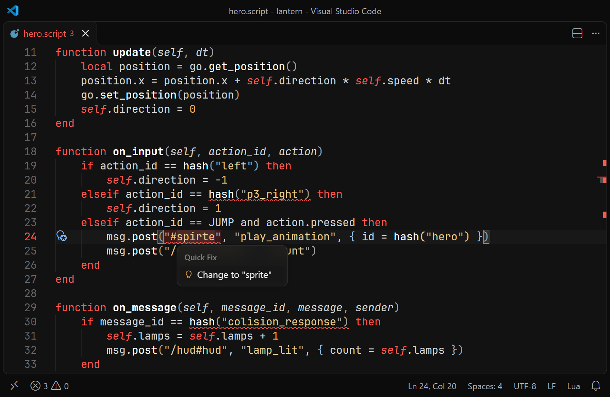
</td>
</tr>
</table>

### Names complete inside strings

<table>
<tr>
<td width="40%" valign="top">

```lua
msg.post("/
```

Type the first quote and the slash, and you are offered the game objects that exist,
each with the file it comes from.

</td>
<td>
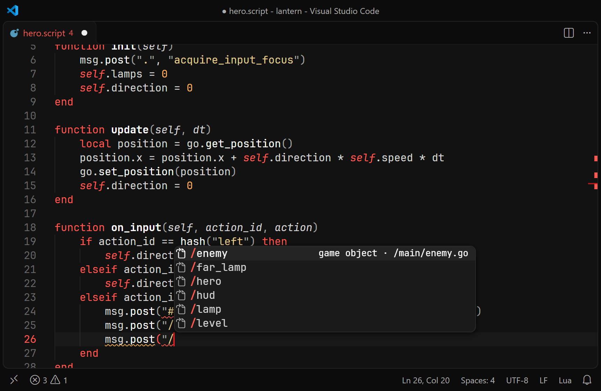
</td>
</tr>
<tr>
<td valign="top">

```lua
msg.post("/hud#hud", "
```

Once the address is written, the second string offers the messages that the script at
that address handles. Here the HUD handles one, `lamp_lit`.

The same goes for properties in `go.get`, input actions in `on_input`, collision
groups, GUI nodes and animations.

</td>
<td>
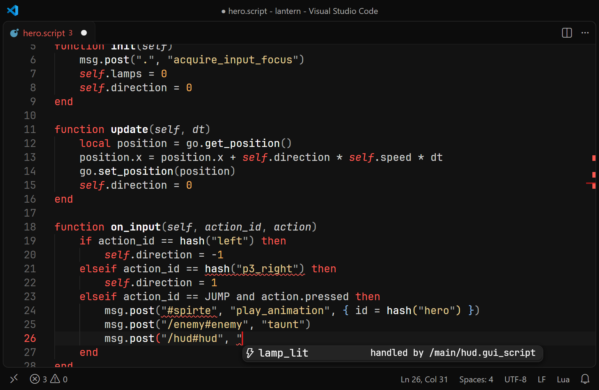
</td>
</tr>
</table>

### Hover says what a name is

<table>
<tr>
<td width="40%" valign="top">

```lua
msg.post("/enemy#enemy", "taunt")
```

Point at a name to see where it comes from. For a message: who handles it and who
posts it. For an address: the game object and the component. For a message or a
property of the engine: its documentation.

`F12` jumps there: from a post to the handler, from an address to the component, from
an action to the key that triggers it.

</td>
<td>
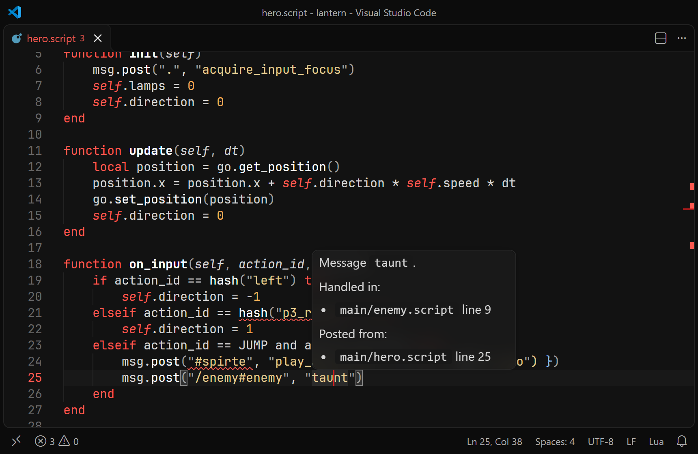
</td>
</tr>
</table>

### Find every place a name is written

<table>
<tr>
<td width="40%" valign="top">

Put the cursor on a name and press `Shift+F12`.

It is not a text search. `"taunt"` the message and `"taunt"` an animation are different
things, and only the one under the cursor is listed, in scripts and in data files.

</td>
<td>
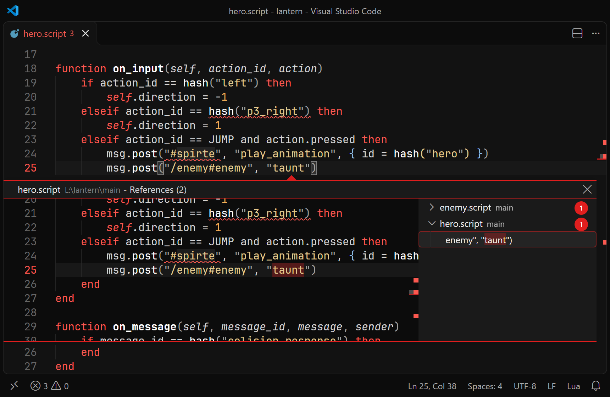
</td>
</tr>
</table>

### Rename it everywhere at once

<table>
<tr>
<td width="40%" valign="top">

Press `F2` on a name and type the new one. `Ctrl+Enter` shows what will change before
anything does.

Messages, input actions, collision groups, GUI nodes, components, game objects,
collections placed inside collections, animations and script properties can all be
renamed, across scripts and data files in one go.

A rename that could not be complete is refused, with the reason. It would rather do
nothing than half.

</td>
<td>
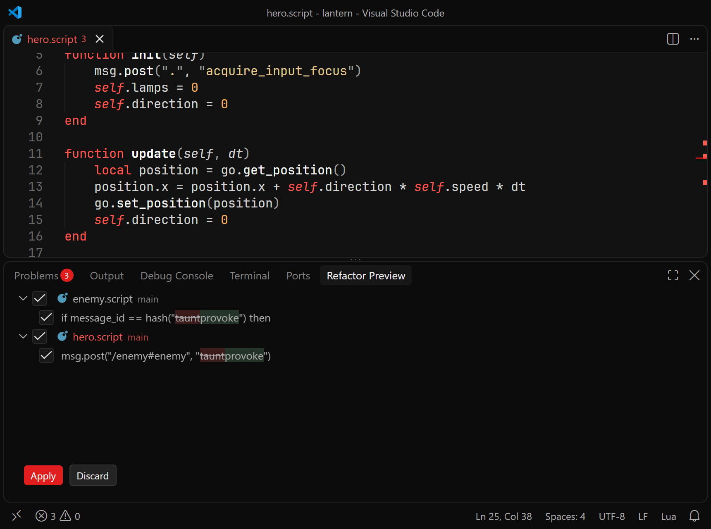
</td>
</tr>
</table>

### Data files get help too

<table>
<tr>
<td width="40%" valign="top">

```
instances {
  id: "hero"
  prototype: "/main/
```

Collections, game objects, GUI scenes, atlases and the other data files of Defold are
text, and they get the same treatment: completion of the files a field takes and of
the names it may hold, hover on a path, and `F12` on a path to open the file.

</td>
<td>
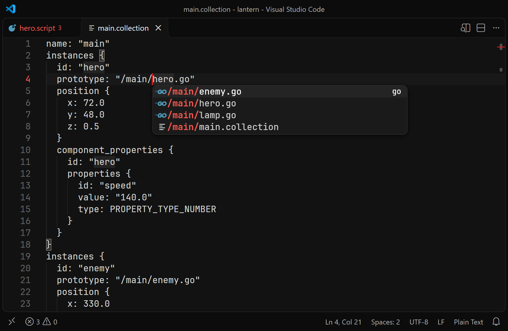
</td>
</tr>
</table>

### See what a file draws

A collection is a list of positions. An atlas is a list of file names. Reading them
tells you little, so the extension draws them next to their text. Click something in
the picture and its line is selected. Move the cursor to a line and what it places is
outlined. The wheel zooms and dragging moves the picture.

<table>
<tr>
<td width="50%">
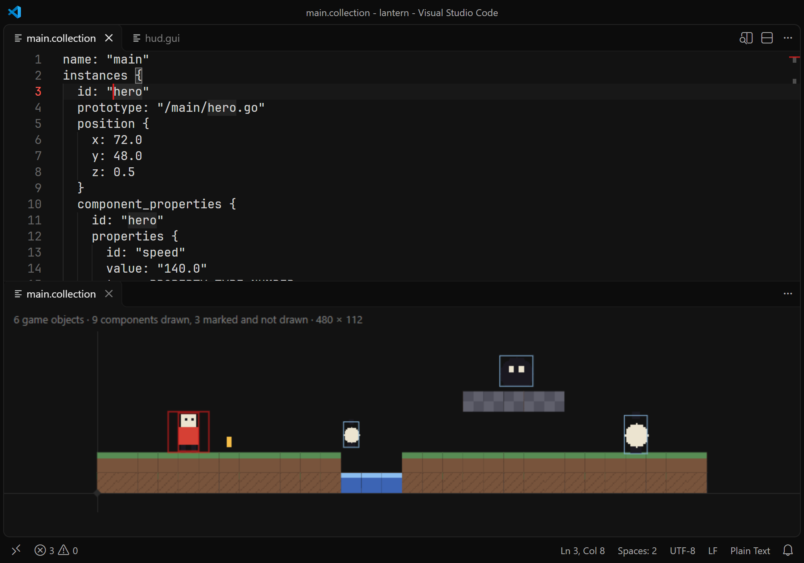
</td>
<td width="50%">
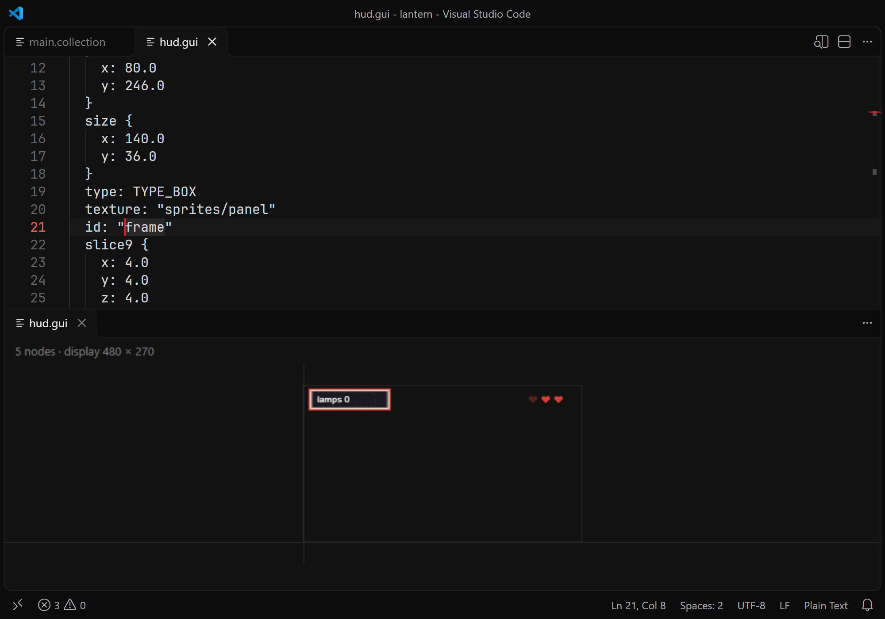
</td>
</tr>
<tr>
<td align="center"><b>A collection or a game object</b>: sprites, tile maps, labels and collision shapes, where their parents put them</td>
<td align="center"><b>A GUI scene</b>: every node inside the display of the game, templates included</td>
</tr>
<tr>
<td>
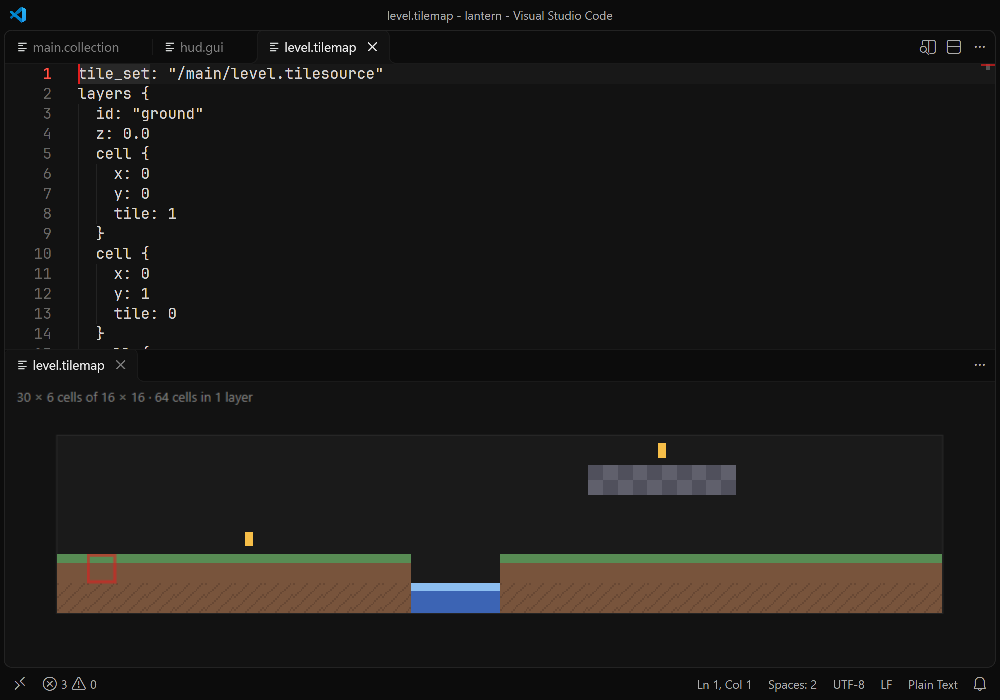
</td>
<td>
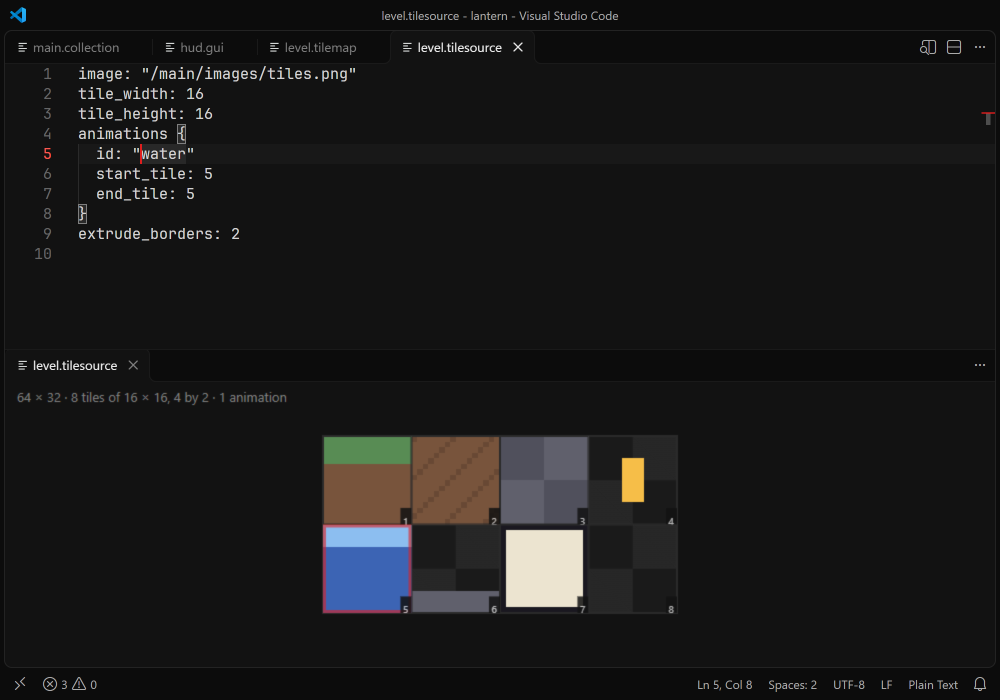
</td>
</tr>
<tr>
<td align="center"><b>A tile map</b>: its cells, layer by layer</td>
<td align="center"><b>A tile source</b>: each tile with its number, the tiles of an animation outlined</td>
</tr>
<tr>
<td>
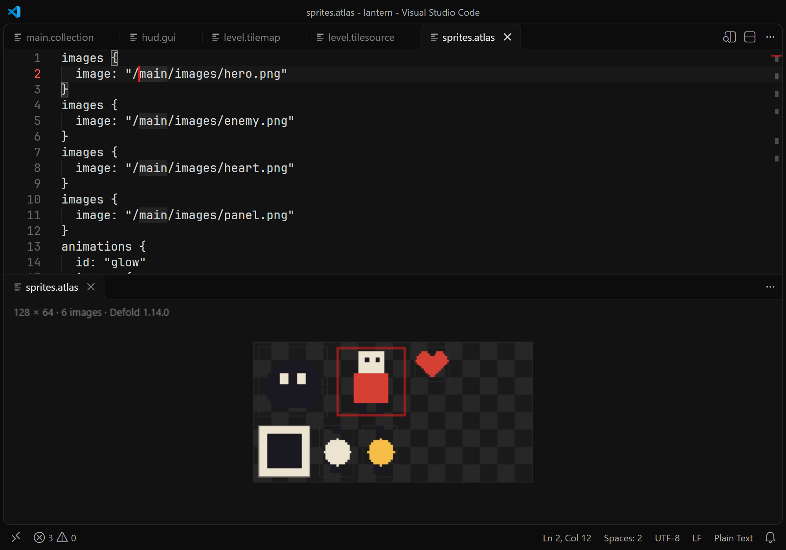
</td>
<td valign="top">

**An atlas**: the page as Defold's own build tool packs it, with every image where it
really lands. This one takes a few seconds and needs the Defold editor installed. The
others need nothing and follow what you type.

These are layouts, not the game. Materials, fonts as the game renders them, particles
and 3D models are still best seen in the Defold editor.

</td>
</tr>
</table>

### Make new files

<table>
<tr>
<td width="40%" valign="top">

Right-click a folder and choose **Defold: New File...**, or run it from the command
palette. Pick the kind, name it, and say what it is made from when it needs something:
a tile source needs an image, a factory needs a game object.

Seventeen kinds of file, and each one is a file Defold builds as it is.

</td>
<td>
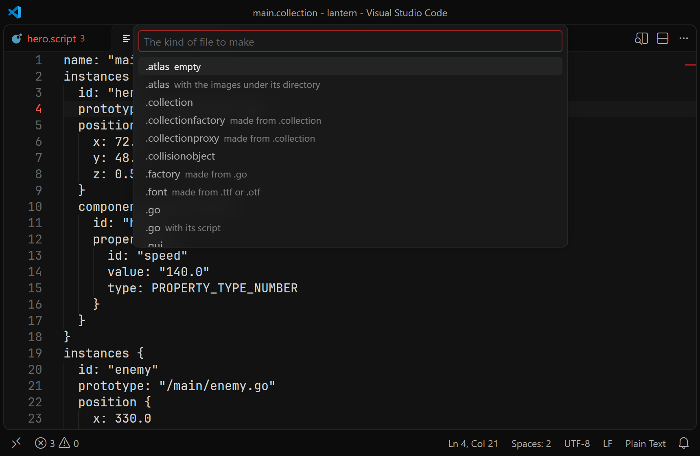
</td>
</tr>
</table>

The same from a terminal. Each command prints the files it wrote:

```console
$ defoldpls new main/coin.script
main/coin.script

$ defoldpls new --script main/door.go
main/door.go
main/door.script

$ defoldpls new --from main/ui main/ui.atlas
main/ui.atlas
```

The last one made an atlas out of every image in a folder. Later, when images were
added to that folder or deleted from it, one command brings the atlas up to date and
touches nothing else in it:

```console
$ defoldpls atlas main/ui.atlas
+ /main/ui/star.png
```

Nothing is ever written over a file that exists.

### Move a file without breaking the game

Rename or drag a file in the VS Code explorer and every place that names it follows:
the collection that uses the game object, the sprite that uses the atlas, the
`require` of a Lua module. From a terminal:

```console
$ defoldpls uses main/sprites.atlas
main/enemy.go:12:17
main/hero.go:12:17
main/hud.gui:8:13
main/lamp.go:8:17

$ defoldpls move main/images assets/images
~ main/level.tilesource
~ main/sprites.atlas
main/images -> assets/images
```

`uses` answers "what breaks if I delete this?". `move` moved a whole folder of images
and rewrote the two files that named them.

### Build, run and hot reload

No need to keep the Defold editor open. The extension uses the one that is installed:
its Java, its build tool and its engine.

| In VS Code | In a terminal | What happens |
|---|---|---|
| **Defold: Build** | `defoldpls build` | The game is built. Errors go to the Problems panel |
| **Defold: Build and Run** | `defoldpls run` | The game is built and started, and what it logs is shown |
| Save a script while the game runs | `defoldpls reload main/hero.script` | The running game takes the file again, without restarting |
| **Defold: Fetch Libraries** | `defoldpls resolve` | The libraries the project depends on are downloaded |
| **Defold: Clean the Build** | `defoldpls clean` | What was built is deleted |
| **Defold: Stop the Game** | `Ctrl+C` | The game is stopped |

A project with native extensions works too: the engine with the extensions in it is
built by Defold's build server, as it is from the Defold editor, and that is the
engine that runs.

### Debug with breakpoints

<table>
<tr>
<td width="34%" valign="top">

Click to the left of a line number to set a breakpoint, and press `F5`.

The game stops there. You see the local variables, what `self` holds and how the game
got to that line, and you can step line by line or type an expression in the debug
console.

There is no `launch.json` to write and nothing to add to the project.

</td>
<td>
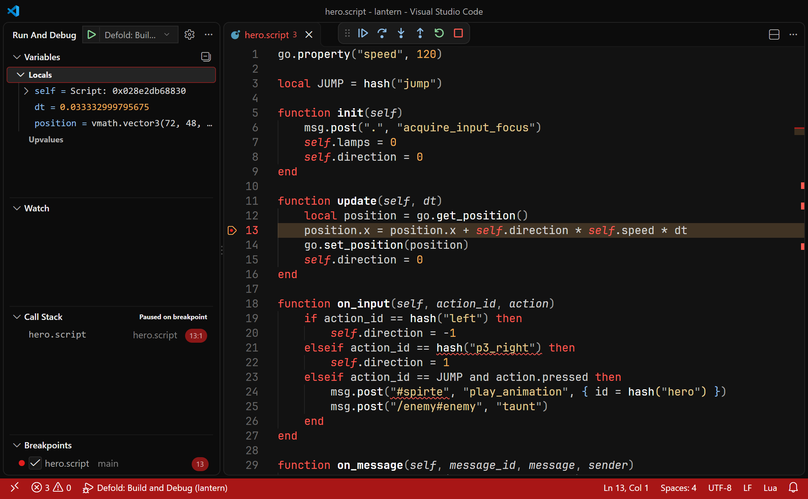
</td>
</tr>
</table>

### Bundle the game

**Defold: Bundle the Game** asks for a platform and packs the game for it. From a
terminal:

```console
$ defoldpls bundle --platform wasm-web
bundled for wasm-web into dist/wasm-web
```

The bundle goes to `dist/<platform>` in the project, and the build you run and debug
is left as it was. `--variant debug` makes a debug bundle, and whatever comes after
`--` goes to Defold's build tool as it is, for a keystore or an identity.

### The Defold API, and its reference without a network

Defold Tools does not reimplement Lua completion. It hands the Lua extension the API
of the Defold version your project targets, so `go.`, `msg.`, `vmath.` and the rest
complete with their parameters and documentation. Every version from 1.6.0 on is
supported.

**Defold: Open the Offline Reference** opens the reference of that version in the
browser, served from your own machine. It works on a plane.

```console
$ defoldpls docs
http://127.0.0.1:34751/1.14.0/
```

### The same checks in a terminal and in CI

Everything the editor underlines can be printed, by the other program:

```console
$ defold-vet check
main/hero.script:21:25: "p3_right" is not bound in /input/game.input_binding [unbound-action]
main/hero.script:24:18: "#spirte": "/hero" has no component "spirte" (did you mean "sprite"?) [unresolved-url]
main/hero.script:30:22: "colision_response" is handled here, but nothing in the project posts it (did you mean "collision_response"?) [unposted-message]
```

It reads the project and writes nothing. It exits with 0 when it finds nothing and
with 1 when it finds something, which is all a CI job or a git hook needs:

```yaml
defold-vet:
  image: golang:1.27
  script:
    - go install github.com/Lanterna-Games/defold-tools/cmd/defold-vet@latest
    - defold-vet check
```

**Strict mode** is on by default. Besides what is wrong, it reports what it could not
check, such as a name that is only known while the game runs:

```lua
go.property("mood", hash("enemy"))
...
sprite.play_flipbook("#sprite", self.mood)
```

```
main/enemy.script:11:41: the animation played here cannot be read [unverifiable]
```

Nothing is known to be wrong on that line. The report says that nobody looked.

**When it is wrong, or you know better**, silence one line with a comment that names
the check and says why. The report is gone:

```lua
sprite.play_flipbook("#sprite", self.mood) -- defold-vet:ignore unverifiable the mood is set in the collection
```

## Commands

### In VS Code

Press `Ctrl+Shift+P` and type `Defold`.

| Command | What it does |
|---|---|
| **Build** | Build the game with the Defold editor installed on the machine |
| **Build and Run** | Build the game and run it, with what it logs in the terminal |
| **Build and Debug** | Build the game and run it under the debugger. The same as `F5` |
| **Hot Reload This File** | Save the file and have the running game take it again |
| **Stop the Game** | Stop the game, whether it runs or is being debugged |
| **Clean the Build** | Delete what was built |
| **Fetch Libraries** | Fetch the libraries the project depends on |
| **Bundle the Game** | Build the game for a platform and pack it into `dist/<platform>` |
| **New File...** | Make a file of the game. Also on a folder of the explorer |
| **Bring This Atlas in Line with the Images on Disk** | Add the images that are new and take out those that are gone |
| **Show What This File Draws** | Draw an atlas, tiles, a game object, a collection or a GUI scene next to its text |
| **Show What Uses This File** | List every place of the project that names the open file |
| **Open the Offline Reference** | Open the reference of the project's Defold version in the browser |
| **Use the API Annotations in This Workspace** | Point the Lua extension at the Defold API |
| **Restart the Language Server** | Start `defoldpls` again, for instance after updating it |

### In a terminal

Run them from the folder of the game.

| Command | What it does |
|---|---|
| `defold-vet check` | Check the project and print what is wrong |
| `defoldpls build` | Build the game |
| `defoldpls run` | Build the game and run it |
| `defoldpls reload <file>...` | Have the running game take the files again |
| `defoldpls resolve` | Fetch the libraries |
| `defoldpls clean` | Delete what was built |
| `defoldpls bundle` | Build for a platform and pack |
| `defoldpls new <file>` | Make a file of the game |
| `defoldpls atlas <file>` | Bring an atlas in line with the images on disk |
| `defoldpls move <from> <to>` | Move a file or a folder, and write its new path wherever it is named |
| `defoldpls uses <file>` | Print every place that names a file |
| `defoldpls docs` | Serve the offline reference and print its address |
| `defoldpls annotations` | Write the API for the Lua extension and print where it is |
| `defoldpls fetch <version>...` | Fetch the documentation of Defold versions, to have it offline later |
| `defoldpls help` | Print all of them, with their options |

## Settings

The extension works without any. These are there if you need them:

| Setting | What it is for |
|---|---|
| `defoldTools.server.path` | Where `defoldpls` is, when it is not in the `PATH` |
| `defoldTools.defoldHome` | Which Defold editor to build with. Without it, the one that was opened last |
| `defoldTools.reloadOnSave` | `false` to reload a script only when asked |
| `defoldTools.showWithTheFile` | `false` to draw a file only when asked |

A project can have a `defold-vet.toml` next to its `game.project`. It needs none: this
one shows what can be said.

```toml
defold = "1.14.0"          # the Defold version the project targets
strict = false             # do not report what cannot be verified

[checks]
unknown-collision-group = false

[[ignore]]
check = "missing-resource"
path = "assets/generated/**"
reason = "written by the build"
```

[Settings](docs/defold-vet/settings.md) explains each line.

## When something goes wrong

**`defold-vet: command not found`, or `defoldpls` is not recognised.**
The programs are in the `bin` folder of Go and your terminal does not look there. Run
`go env GOPATH` to see where Go keeps things, add its `bin` folder to your `PATH` as in
[Installing the programs](#installing-the-programs), and open a new terminal.

**VS Code says *defoldpls could not be started*.**
VS Code cannot find the program. Set `defoldTools.server.path` to its full path, as in
[Installing the VS Code extension](#installing-the-vs-code-extension-by-hand).

**Nothing is underlined and nothing completes.**
The extension wakes up for a folder with a `game.project` directly in it. Open that
folder itself. Then look at **View > Output** and choose **Defold Tools** in the list:
what the program complained about is there.

**`no Defold editor was found`.**
Building, running, debugging and bundling use the Defold editor installed on the
machine, and it is found once it has been opened at least once. If yours is somewhere
unusual, set `defoldTools.defoldHome` to its folder, or the `DEFOLD_HOME` variable in a
terminal.

**`go`, `msg` and `hash` are underlined as unknown.**
That is the Lua extension, which has not been told about Defold yet. Run **Defold: Use
the API Annotations in This Workspace**.

**`F5` does nothing, or complains about a launch configuration.**
The project has a `launch.json` from another extension. Defold Tools offers to replace
it. Deleting `.vscode/launch.json` works as well: `F5` needs none.

**It reports a problem that is not one.**
It tries hard not to, and sometimes it is wrong. Silence the line with a comment, as in
[the example above](#the-same-checks-in-a-terminal-and-in-ci), and carry on.

**The picture of an atlas takes a while.**
It is packed by Defold's real build tool, which takes a few seconds to start. The other
pictures are instant.

## What it does not do

- **It is not the Defold editor.** Materials, fonts as the game renders them, particle
  effects, 3D models and the other layouts of a GUI scene are Defold's to show. The
  pictures here are layouts.
- **It does not write your data files behind your back.** It changes a project only
  when you ask: a rename, a move, a new file, an atlas brought up to date.
- **It does not check what is only known while the game runs.** A name built at run
  time cannot be verified, and strict mode points at those places.
- **It does not check C++ or shaders.** Native extensions are built and run, not read.
- **It has no releases.** You build it from the code, as above.

## Going deeper

- [defold-vet](docs/defold-vet/README.md): [the checks](docs/defold-vet/checks.md),
  [how a project is read](docs/defold-vet/how-it-reads.md),
  [strict mode](docs/defold-vet/strict-mode.md), [settings](docs/defold-vet/settings.md),
  [CI and git hooks](docs/defold-vet/ci.md).
- [defoldpls](docs/defoldpls/README.md): every command, with what it prints, and what
  another editor needs to know to use it.
- [The VS Code extension](editors/vscode/README.md).
- [The decisions](docs/decisions/README.md): why Go, why the source has no comments, why
  a check would rather stay quiet than be wrong. Each choice is written down with its
  reasons.
- [Working on the code](docs/working-on-the-code.md), for when you fork it.

It was run over 393 open-source Defold projects while it was written. What each check
reported there was read against the sources, and every wrong report became a fix and a
test.

## Support

There is none, and that is said with affection.

It was made to solve the development problems of Lanterna Games, and that is the
whole of its job. Issues are read by nobody on a schedule known to nobody. Pull
requests are a generous idea that will meet a closed door. Nothing here is a promise,
a roadmap or the start of a beautiful community.

What you can do instead is better anyway: **fork it**. Then it is yours, it does what
you want, and its maintainer answers you within the second.

The fine print, for those who enjoy fine print:
[CONTRIBUTING.md](CONTRIBUTING.md) explains what happens to what you send,
[SECURITY.md](SECURITY.md) explains what happens to a vulnerability you report, and the
[Code of Conduct](CODE_OF_CONDUCT.md) governs a community that does not exist.

## Licence

The [WTFPL](LICENSE), which in the words of its one and only clause means: *you just
DO WHAT THE FUCK YOU WANT TO.*

For those who came for the legal analysis:

| You want to | May you? |
|---|---|
| Use it | Yes |
| Copy it, change it, rename it after your cat | Yes |
| Sell it | The part that is ours, yes. The part that is Defold's may not be sold as a game engine product, and their licence is less relaxed than ours |
| Not credit anyone | Yes |
| Ask a lawyer whether "yes" really means yes | Yes, at your expense |
| Hold Lanterna Games responsible when it eats your weekend | No. This is the one part written in capital letters |
| Receive support, updates or sympathy | See [Support](#support) |

It comes with no warranty of any kind, which is the legal way of saying *it works
here*.

One part is not ours to joke about. The programs carry the reference documentation of
Defold, which belongs to the Defold Foundation and stays under the
[Defold License](licenses/Defold-License-1.0.txt). The [NOTICE](NOTICE) says what that
means in plain words.

Defold Tools is not affiliated with the Defold Foundation, who are busy making an
engine and have done nothing to deserve the blame.
